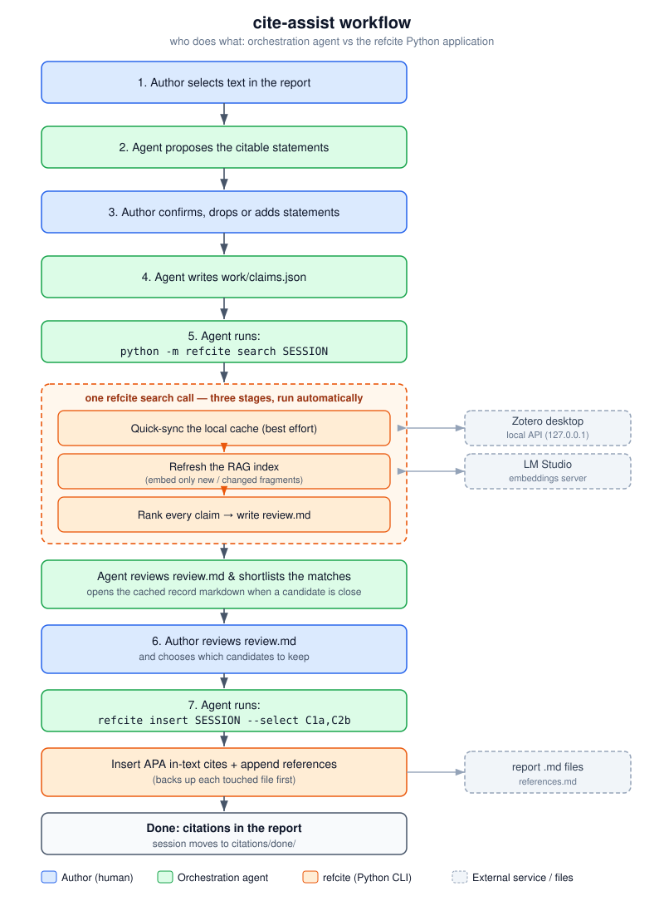

# cite-assist — citation assistant

`cite-assist` adds **APA** citations to a report by drawing on your own Zotero
library. It has two halves:

- **`refcite`** — a small Python command-line tool. It caches your Zotero
  library locally, searches it for sources that support statements in the
  report, writes a human-reviewable `review.md`, and inserts APA in-text
  citations plus a shared reference list back into the report.
- **The `cite-assist` skill** — an orchestration layer for VS Code Copilot,
  Codex, Claude Code, or another compatible agent harness
  that reads your selected text, decides *what* should be cited, drives the
  `refcite` commands for you, and relays results in plain language. `SKILL.md`
  is the prompt that defines this behaviour.

You can run the whole thing through the agent, or drive `refcite` by hand — the
agent only ever shells out to the same CLI you can run yourself. See
[DESIGN.md](DESIGN.md) for the full design and rationale.

**Search runs one of two ways:** a **semantic RAG** search powered by a local
embedding model (served from **LM Studio** or **Ollama**, so nothing leaves your
machine), or a **pure-Python keyword engine** (BM25) that needs no model server
and no third-party packages at all. The semantic option finds sources by meaning;
the Python-only option always works with zero setup. See
[Search backends](#search-backends--strengths-and-weaknesses).

---

## Install

cite-assist installs as a **personal skill** — a folder under your home
directory that your agent harness loads automatically in every project. It
bundles the `refcite` tool, so the only requirement is system **Python 3.11+**.

The easy way: ask your AI assistant to do it. Tell VS Code Copilot, Codex,
Claude Code, or another compatible agent:

> Please install the cite-assist skill from https://github.com/open-AIMS/cite-assist

The agent will follow [`INSTALL.md`](INSTALL.md) — choose the right skill folder
for your harness, verify Python, configure the cache and search backend, and
(optionally) help connect Zotero and LM Studio.

To install it manually:

```bash
SKILL_DIR="$HOME/.codex/skills/cite-assist"  # or ~/.copilot/skills/cite-assist, ~/.claude/skills/cite-assist
git clone https://github.com/open-AIMS/cite-assist "$SKILL_DIR"
PYTHONPATH="$SKILL_DIR" python -m refcite status
```

Then follow [`INSTALL.md`](INSTALL.md) from step 5 (configuration). After
installing, reload or restart your agent harness so the **`cite-assist`** skill
is discovered.

---

## Contents

- [Install](#install)
- [How it works at a glance](#how-it-works-at-a-glance)
- [The two halves: agent vs application](#the-two-halves-agent-vs-application)
- [Ways to use it](#ways-to-use-it)
- [Choice of orchestration agent](#choice-of-orchestration-agent)
- [Requirements](#requirements)
- [Search backends — strengths and weaknesses](#search-backends--strengths-and-weaknesses)
- [Setting up LM Studio for conceptual search](#setting-up-lm-studio-for-conceptual-search)
- [How the RAG search works](#how-the-rag-search-works)
- [How Zotero syncing works](#how-zotero-syncing-works)
- [Enabling the Zotero local API](#enabling-the-zotero-local-api)
- [Running the CLI](#running-the-cli)
- [Commands](#commands)
- [Typical workflow](#typical-workflow)
- [Files it creates](#files-it-creates)
- [Configuration](#configuration)
- [Scalability and known limitations](#scalability-and-known-limitations)
- [Notes and limits](#notes-and-limits)

---

## How it works at a glance



The blue steps are the **author**, the green steps are the **agent**, and the
orange steps are the **`refcite` Python application** doing the work; the dashed
grey boxes are external services (Zotero, an embeddings server) and the report
files. The three orange stages sit inside one box because they are a **single
`refcite search` call** — quick-sync, index refresh, and ranking happen
automatically; the agent never runs them separately.

After ranking, the agent reads `review.md` first and **shortlists the strongest
matches** (opening a cached record's markdown when a candidate is borderline), so
the author considers a narrowed set rather than every candidate. `review.md`
carries enough — a confidence label and the best supporting extracts — for a
moderate judgement from the extracts alone, with a `Cache:` path for deeper
review when needed.

The crucial split: the **agent decides *what* to cite and narrates the process**
(it reads the prose, proposes the citable statements, picks search terms, and
explains the candidates). The **Python application does the deterministic
work** — caching the library, building the search index, ranking sources, and
editing the report. Nothing the application does requires the agent; the agent
just makes the workflow conversational and removes the need to remember
commands.

---

## The two halves: agent vs application

| | Orchestration skill (`SKILL.md`) | `refcite` Python application |
|---|---|---|
| **Runs in** | A compatible agent harness such as VS Code Copilot, Codex, or Claude Code | Your terminal / the agent shells out to it |
| **Owns** | Judgement and language | Data and determinism |
| **Does** | Reads selected prose; proposes which statements to cite; classifies each claim (background / method / own-project / common-knowledge); picks search terms; explains candidates; relays Zotero/setup problems in plain words | Caches the library; syncs from Zotero; builds the search index; ranks sources; writes `review.md`; inserts citations and references into the report |
| **Never** | Invents a citation, author, year, DOI or quotation; edits `review.md` on your behalf unless asked | Makes a relevance *judgement* — it only ranks and presents; the human (with or without the agent) decides what to keep |
| **Needed?** | Optional — convenience and judgement. You can do its job yourself by editing `claims.json` and reading `review.md` | Always — it is the engine. The agent is useless without it |

If you removed the agent entirely, `refcite` would still work: you would write
`claims.json` yourself, run `refcite search`, read `review.md`, and run
`refcite insert`. The agent exists so you do not have to.

---

## Ways to use it

There are three practical modes, from most to least hands-off:

1. **Fully agent-driven (recommended).** In VS Code, select a block of report
   text and invoke the `cite-assist` agent. It proposes the statements to cite,
   waits for your confirmation, runs `search`, shows you the candidates, and on
   your say-so runs `insert`. You never type a command.

2. **Agent for judgement, you for control.** Let the agent scaffold the session
   and write `claims.json`, then run the `search` / `insert` commands yourself
   in a terminal so you can see exactly what happens. Useful while learning the
   tool or debugging a sync.

3. **Manual CLI, no agent.** Drive `refcite` entirely by hand: scaffold a
   session, hand-edit `work/claims.json`, run `search`, read `review.md`, run
   `insert --select`. Everything the agent does is available as a command (see
   [Commands](#commands)). This is also how you would script or batch the tool.

Whichever mode you use, the **handoff files are the same** (`claims.json`,
`review.md`), so you can switch between agent and manual at any step.

---

## Choice of orchestration agent

The workflow leans heavily on the orchestration agent to follow a disciplined
sequence (propose statements → **wait for confirmation** → search → shortlist
candidates → **wait for selection** → insert) and to make sound relevance
judgements. Models differ a lot in how reliably they do this, and our experience
so far is limited to two:

- **Claude Opus 4.8** — follows the workflow reliably and efficiently. It
  proposes the citable statements, waits for confirmation, runs the commands in
  the right order, shortlists candidates sensibly, and stays on task. This is the
  model the workflow has been tuned against.
- **Gemini 3.5 Flash** — noticeably less consistent. It sometimes skips the
  confirmation steps (proposing the statements to analyse, or which candidates to
  apply), wanders off to read files unrelated to the task, and is uneven at
  picking citable statements — sometimes suggesting far too many, sometimes
  missing obvious ones.

The practical guidance: **prefer a strong reasoning model** for this agent. If
you use a lighter or faster model, watch for skipped confirmation steps and
over- or under-selection of statements, and steer it back when it strays. Because
the handoff files (`claims.json`, `review.md`) are the source of truth, you can
always correct course — edit them directly, or re-run a step — regardless of how
well the agent behaved. This list will grow as more models are tried.

---

## Requirements

- **Python 3.11+** (uses the stdlib `tomllib`). The baseline needs **no
  third-party packages** — it runs on a clean system Python.
- **Zotero desktop** running, only when you want to *refresh* the cache. Search
  and insert work fully offline against the cache.
- Optional: a local **embeddings server** (LM Studio or Ollama) for conceptual
  search — see below. Optional **`PyMuPDF`** for the PDF-text fallback
  (`requirements-optional.txt`), only needed when Zotero's own full-text API
  cannot supply a document's text.

---

## Search backends — strengths and weaknesses

The search backend is chosen in `cite-assist.toml` (`[search] backend`). All
three return the same kind of ranked candidates; they differ in *how* they
decide relevance.

| Backend | How it ranks | Strengths | Weaknesses | Needs a server? |
|---|---|---|---|---|
| **`bm25`** (default) | Classic keyword scoring — IDF-weighted term overlap between your query and each fragment | Zero setup, pure stdlib, instant index, fully offline, predictable | Literal: misses synonyms and paraphrases ("turbid reef" won't match "muddy-water coral"); easily fooled by shared common words | No |
| **`embeddings`** | Semantic — encodes the query and every fragment as vectors via a local model, ranks by cosine similarity | Conceptual: matches meaning, finds paraphrases and related ideas; far better recall on natural-language claims | Needs a running embeddings server; the index takes time to build (one HTTP call per batch of fragments); only as good as the model | Yes |
| **`hybrid`** | Runs both `bm25` and `embeddings`, fuses the two rankings by reciprocal-rank fusion | Best overall recall — keyword precision plus semantic reach; a strong match in *either* method surfaces | Slowest to build and query; still needs the embeddings server | Yes |

**Which to pick.** Start with `bm25` to confirm the workflow with no setup. Move
to `embeddings` (or `hybrid`) once you want the search to understand meaning
rather than match words — this is the single biggest quality improvement, and it
is what makes the candidate ranking strong enough to trust. `hybrid` is the most
thorough but rarely changes the outcome enough to justify the extra cost on a
small library of papers.

> **On confidence labels.** Each candidate in `review.md` is tagged high /
> medium / low. That label is **relative to the best match for that same
> claim** (`ratio = score / top_score`), not an absolute measure — so the top
> candidate is always "high" even if every match for that claim is weak. Treat
> the labels as a within-claim ordering, not a global quality bar, and do not
> auto-drop "low" candidates without reading them. A stronger backend
> (`embeddings`) makes the ordering meaningful; calibrated absolute thresholds
> would require labelled data and are not enabled by default
> (`needs_source_threshold = 0`).
>
> **The real relevance judgement is the orchestration agent's, not the score.**
> The labels and ranking only *order* candidates; deciding which source actually
> supports a statement relies on the agent reading the extracts (and, when
> borderline, the cached record) and recommending the genuinely relevant ones —
> exactly the shortlisting step in the workflow diagram. The numbers narrow the
> field; the agent's reading is what makes the recommendation trustworthy, and
> the author still has the final say.

---

## Setting up LM Studio for conceptual search

The `embeddings` and `hybrid` backends need a local server that exposes an
embeddings endpoint. **LM Studio** is the default (`[embeddings] server =
"lmstudio"`); Ollama is also supported, but has not been tested. LM Studio is free, runs the model
entirely on your machine (nothing leaves your computer), and the recommended
model is small enough to run on almost any laptop without a GPU.

**Recommended model: Google EmbeddingGemma 300M.** It is a 300-million-parameter
embedding model (768-dimensional vectors, ~2048-token context). At that size it
loads in well under a gigabyte of RAM and embeds the whole library in minutes on
ordinary hardware, while giving genuine semantic search quality. This is the
model the project's `cite-assist.toml` is configured for:
`text-embedding-embeddinggemma-300m-qat` (the `-qat` quantised build is the
smallest).

Steps:

1. **Install LM Studio** from <https://lmstudio.ai> and open it.
2. **Download the embedding model.** In the search/discover tab, search for
   `embeddinggemma` (Google's EmbeddingGemma 300M) and download the QAT /
   quantised variant. Any embedding model LM Studio lists will work; this one is
   chosen for its tiny footprint.
3. **Start the local server.** Open the **Developer / Local Server** tab and
   start the server. LM Studio exposes an OpenAI-compatible API at
   `http://localhost:1234` by default, with the endpoint `/v1/embeddings`.
4. **Load the embedding model** into the server (select it as the served model).
5. **Point `cite-assist.toml` at it** (these are already the defaults):

   ```toml
   [search]
   backend = "embeddings"      # or "hybrid"

   [embeddings]
   server = "lmstudio"         # OpenAI-compatible
   url = "http://localhost:1234"
   model = "text-embedding-embeddinggemma-300m-qat"
   ```

6. **Build the index** (or just run `search`, which builds it on demand):

   ```bash
   PYTHONPATH="$SKILL_DIR" python -m refcite index
   ```

   The first build embeds every fragment and prints a live progress line; later
   builds re-embed **only the fragments whose text changed**.

If the server is not running when you search, `refcite` reports the connection
error rather than silently degrading, so you know to start LM Studio (or switch
the backend back to `bm25`).

**Using Ollama instead.** Set `[embeddings] server = "ollama"` and `url` to your
Ollama host; it uses `POST /api/embeddings`. Pick any embedding model you have
pulled.

---

## How the RAG search works

"RAG" here means: the report claim is the query, and the tool *retrieves* the
best-matching passages of your library to support it (it does not generate text
from them — the human writes the citation). The pipeline:

1. **Cache → records.** Each Zotero item becomes one markdown *record* with
   citation metadata in its front matter and the document text (or abstract, or
   just title+tags) as its body. Each record is tagged a `content_tier`:
   `full`, `abstract`, or `meta`.

2. **Records → fragments (chunking).** `full`-text records are split into
   **fragments** of about 120 words, aligned to paragraph boundaries where
   possible. Two guards keep fragments useful:
   - **Maximum size** (`fragment` cap, ~220 words): a single huge
     paragraph-on-one-line — common in PDF-extracted text — is split by words so
     it never overruns the embedding model's context window.
   - **Minimum size** (`fragment_min_words`, default 30): a stray short chunk
     (e.g. a lone heading like *"Drivers of coral recovery"*) is merged into its
     neighbour, so every fragment carries enough surrounding context to judge
     and headings stay attached to their section.

3. **Fragments → index.** For `bm25` the index is a single JSON term table. For
   `embeddings`/`hybrid` each fragment is encoded into a vector by the model
   server and stored in a **sharded, resumable index** (~20 shard files under
   `index/embeddings/`). A rebuild reuses every cached vector whose fragment text
   is unchanged (matched by a stored hash) and re-embeds only the rest, so
   editing one record does not re-embed the whole library.

4. **Claim → query → ranking.** For each claim, the search term (chosen by the
   agent, or the sentence itself) is scored against every fragment. The best
   fragment per record sets that record's score; records are deduplicated by
   title and the top `top_k` survive. `own-project` claims get a configurable
   score bias toward your own Zotero collections (they are *biased*, never
   *restricted*).

5. **Ranking → `review.md`.** Each surviving candidate is rendered with its APA
   in-text form, a confidence label, a path to the full cached record, and the
   **best few distinct supporting extracts** from the document
   (`extracts_per_doc`, default 2) — not just its single top fragment — so you
   can confirm relevance from the review file without opening Zotero.

`Fragment` records carry a `parent_fragment_id` so a later enrichment stage
(multi-perspective / doc2query vectors pointing back to the same fragment) can be
added without changing the index format.

---

## How Zotero syncing works

The cache is the tool's source of truth; Zotero is only contacted to *update*
it. Sync is **incremental and safe**:

1. **Version check.** `refcite` reads Zotero's current library version over the
   local API and compares it to the cached `manifest.json`.
   - **Unchanged** → return immediately (nothing to do).
   - **Small delta** → fetch only the changed items, re-extract those, bump the
     manifest.
   - **Large delta, or Zotero closed/unreachable** → **skip, warn, and use the
     existing cache** (run a manual full `sync` when ready). This is why a quick
     sync can safely run inside every `search`.

2. **What becomes a record.** Only **top-level** items (`/items/top`) become
   records — child notes and attachments are excluded at the source. Each item's
   **child notes** are stripped of HTML and appended to the parent record's body
   as a searchable `Curator note:` block (a note is the curator's read of *why* a
   source matters, so it should be findable — under the parent's citation, not as
   a junk record of its own).

3. **Document text.** For each item the tool tries Zotero's own full-text API
   first (`/items/<key>/fulltext`). If that is empty and `PyMuPDF` is installed,
   it extracts from the attached PDF; otherwise the record is flagged
   `has_fulltext: false` and tiered down to `abstract`/`meta`. Scanned,
   text-less PDFs are flagged, not OCR'd.

4. **Crash-safe and visible.** Records are written to disk **as each item is
   fetched** and the manifest is flushed periodically, so a long first sync fills
   the cache visibly and an interrupted run keeps what it already fetched. A live
   progress line goes to `stderr` (`Fetching items from Zotero: [120/471] 25%
   ...`) while `stdout` stays machine-readable.

5. **Performance note.** The local API is addressed as `127.0.0.1`, never
   `localhost` — on Windows `localhost` resolves to IPv6 first while Zotero
   listens only on IPv4, adding a ~2s stall to every one of the 1000+ requests in
   a full sync.

**Offline alternative.** If you cannot use the live API, a `File > Export > CSL
JSON` export can seed the cache (`refcite sync --from-csljson FILE`). That path
has citation metadata but **no collection folders and no full text**, so
own-project biasing and full-text search need the live API.

## Enabling the Zotero local API

`refcite sync` talks to the Zotero desktop app's built-in **local API**. It is
off by default. To turn it on:

1. Open **Zotero**.
2. Go to **Settings → Advanced**.
3. Enable **"Allow other applications on this computer to communicate with
   Zotero."**

While it is off, local-API requests return **`403 Forbidden`** and `refcite`
falls back to the existing cache (or a configured CSL-JSON export). Check the
state at any time with:

```bash
PYTHONPATH="$SKILL_DIR" python -m refcite status
```

The `zotero API:` line reports whether it is reachable, and prints how to fix it
if not. Search and insert work fully offline, so you only need the local API
when refreshing the cache.

## Running the CLI

Run from the **project root** so relative session and report paths resolve. Put
the installed skill folder on `PYTHONPATH`:

```bash
SKILL_DIR="$HOME/.codex/skills/cite-assist"  # or the actual folder containing SKILL.md
PYTHONPATH="$SKILL_DIR" python -m refcite <command>
```

(On git bash / macOS / Linux. The `cite-assist` agent runs this for you.)

## Commands

| Command | What it does |
|---------|--------------|
| `sync` | Update the offline cache from the Zotero local API. `--from-csljson FILE` builds from a `File > Export > CSL JSON` export instead; `--full` forces a rebuild; `--limit N` fetches only the first N items to simulate a smaller library for fast development (a follow-up `sync` is then a quick no-op; use `--full` to rebuild the whole library). |
| `index` | (Re)build the search index from the cache. `search` does this automatically if the index is missing. |
| `search SESSION` | Rank every claim in a session and (re)write its `review.md`. **Self-contained:** quick-syncs the cache, then rebuilds the index if the records changed, before ranking — so an agent only needs this one command after editing `claims.json`. `--no-sync` skips the Zotero sync (the index is still rebuilt if stale); `--collection NAME` restricts to a Zotero collection (repeatable). |
| `insert SESSION` | Insert the kept citations, append references, and move the session to `citations/done/`. `--select C1a,C2b` keeps candidates by code (and prunes the rest from `review.md`) — the recommended alternative to hand-deleting `###` blocks; an unknown code is a hard error. With no `--select`, it keeps whichever candidate blocks are still in `review.md`. |
| `new-session SLUG` | Scaffold `citations/active/<date>_<slug>/work/claims.json` **and report the cache state** (record count + library version; probes Zotero only if the cache is empty), so no separate `status` call is needed. `--report PATH` sets the default report file. |
| `status` | Manual diagnostic: full cache + config summary, including whether the Zotero local API is reachable (`--no-connect` to skip the probe). Not part of the normal flow. |

A first full `sync` fetches every item over the local API, which takes a while
for a large library. It prints a live progress line to `stderr`
(`Fetching items from Zotero: [ 120/471]  25% ...`) so you can see it working;
later incremental syncs only fetch what changed. Building an `embeddings` index
shows the same kind of progress while it encodes fragments.

## Typical workflow

```bash
# 0. (once) cache the library
PYTHONPATH="$SKILL_DIR" python -m refcite sync

# 1. scaffold a session (the agent does this)
PYTHONPATH="$SKILL_DIR" python -m refcite new-session "intro-reef-mapping" --report 01-Introduction.md

# 2. the agent proposes the statements to cite as a numbered list; you confirm,
#    drop or add statements; the agent then writes work/claims.json

# 3. rank candidates -> writes review.md
PYTHONPATH="$SKILL_DIR" python -m refcite search "citations/active/2026-06-17_intro-reef-mapping"

# 4. decide which candidate codes to keep (read them off review.md)

# 5. write the kept citations into the report (keep C1a + C2b)
PYTHONPATH="$SKILL_DIR" python -m refcite insert "citations/active/2026-06-17_intro-reef-mapping" --select C1a,C2b
```

## Files it creates

```
~/.cite-assist/zotero-cache/                # the offline library cache
  manifest.json
  records/0001.md ...
  index/
    bm25.json                # bm25 backend
    embeddings/              # embeddings/hybrid backend (sharded, resumable)
      meta.json
      shard-00.json ...
citations/
  active/<date>_<slug>/
    review.md            # the ONLY file you edit
    work/                # machine files + pre-edit report backups
      claims.json
  done/<date>_<slug>/    # finished sessions
references.md            # shared, append-only APA reference list (you sort it)
```

## Configuration

All settings live in [`cite-assist.toml`](cite-assist.toml). The keys you are
most likely to change:

| Section | Key | Meaning |
|---|---|---|
| `[zotero]` | `api_url` | Zotero local API address (keep `127.0.0.1`, not `localhost`). |
| `[zotero]` | `csljson_export` | Optional offline seed file when the API is unreachable. Note: This is not well tested yet. |
| `[cache]` | `dir` | Where the offline cache lives. |
| `[search]` | `backend` | `bm25` / `embeddings` / `hybrid` (see backends above). |
| `[search]` | `top_k` | Candidates surfaced per claim (default 8). |
| `[search]` | `own_collections`, `own_bias` | Your project's own Zotero folders, and the score multiplier `own-project` claims give them. |
| `[search]` | `extract_words` | Length of each supporting extract in `review.md` (default 120). |
| `[search]` | `extracts_per_doc` | Distinct supporting sections shown per candidate (default 2). |
| `[search]` | `fragment_min_words` | Minimum fragment size; smaller chunks are merged into a neighbour (default 30). |
| `[search]` | `needs_source_threshold` | Absolute score floor to flag NEEDS SOURCE; `0` disables (BM25 scores are unbounded). |
| `[embeddings]` | `server`, `url`, `model` | The embeddings backend (default LM Studio + EmbeddingGemma 300M). |
| `[embeddings]` | `num_shards` | How many shard files the embeddings index is split into (default 20). |
| `[sessions]` | `dir`, `references_file` | Where sessions and the shared APA reference list live. |

All relative paths resolve against the directory you run `python -m refcite`
from; in normal use, that should be the project root for the report you are
citing.

### Notes on particular settings

- **`own_collections` / `own_bias` (own-project biasing).** A formal report often
  needs to cite its *own* outputs — the project's datasets, milestone reports,
  and prior publications. `own_collections` is the list of **Zotero collection
  (folder) names** that hold those outputs. When a claim is classified
  `own-project`, any candidate that lives in one of those collections has its
  score multiplied by `own_bias` (default `1.25`, i.e. a 25% boost), nudging your
  own work up the ranking. It is a **bias, not a filter**: other sources still
  appear, and the bias applies *only* to `own-project` claims — background and
  method claims are unaffected. Set `own_bias = 1.0` to disable the nudge while
  keeping the collection list. (Collection metadata only exists when the cache
  was built from the live Zotero API, not from a CSL-JSON export.)
- **`needs_source_threshold`.** An **absolute** best-score floor: if a claim's
  top candidate scores below it, the claim is flagged `NEEDS SOURCE` rather than
  presenting weak matches as if they were good. It defaults to `0` (disabled)
  because raw BM25 scores are unbounded and not comparable across queries, so any
  fixed floor would be arbitrary. With the `embeddings` backend, cosine scores
  *are* bounded (~0–1) and roughly comparable, so a small floor (e.g. `0.2`) can
  be calibrated against a few known claims if you want automatic flagging.
- **`num_shards`.** How many files the embeddings index is split across. Changing
  it on an existing index is **safe but not free**: a shard-count change
  invalidates vector reuse, so the next `index`/`search` run does a **clean
  re-embed of the whole corpus** (it does not corrupt anything, it just rebuilds
  from scratch). The same is true if you change the embedding `model`. Leave it
  at the default unless inspecting the shard files is awkward.

## Scalability and known limitations

The tool is deliberately simple — plain JSON files, no database, no ML
dependencies — which is what makes it trivial to install and inspect. The cost of
that simplicity is that it is built for a **personal-to-lab-sized library**
(a few hundred to a few thousand items), not a very large corpus.

- **Linear (brute-force) vector search.** The `embeddings` backend scores a query
  by computing cosine similarity against **every** fragment vector, one by one.
  There is no approximate-nearest-neighbour index (FAISS / HNSW), so query time
  grows linearly with the number of fragments. This is fine at a few thousand
  fragments and will become noticeably slow in the tens of thousands.
- **JSON storage loaded into memory.** Both the BM25 index and the embeddings
  shards are read **fully into RAM** for each search. There is no streaming or
  memory-mapping, so peak memory and index load time grow with corpus size. A
  large embeddings index (many thousands of 768-dim vectors) can take a moment to
  load on every run.
- **Large PDFs cost proportionally.** A long document is split into many
  fragments, each of which is embedded and scanned. The fragment size cap
  prevents any single chunk overrunning the model's context window, but a very
  large PDF still produces many embedding calls at build time and many vectors to
  scan at query time.
- **PDF text is used as-is — it is not cleaned.** Document text comes from
  Zotero's full-text extractor (or PyMuPDF) and is **not** post-processed.
  Running headers and footers, page numbers, journal mastheads, line-break
  hyphenation, and multi-column merge artefacts can be injected straight into the
  body text, and therefore into fragments. That noise can pollute both keyword
  and embedding matches (e.g. a footer string repeated on every page becomes a
  spuriously frequent term, or splits a sentence across a page break). There is
  currently no de-headering / footer-stripping or reflowing step.
- **No OCR.** Scanned, image-only PDFs yield no extractable text; they are flagged
  `meta`/`abstract` tier rather than processed.
- **Confidence is relative, not calibrated** — see
  [the note above](#search-backends--strengths-and-weaknesses); automatic
  drop-off of weak candidates is therefore not enabled by default.

None of these are hard blockers at the intended scale; they are the things to
revisit if the library grows large or citation quality on messy PDFs matters more
(a cleaning pass, an ANN index, or a real vector store would each address one of
the points above).

## Notes and limits

- **APA only.** No `[@citekey]` / Better BibTeX.
- `references.md` is **append-only and deduplicated**; sorting is left to you.
- `insert` never edits prose it cannot match with confidence — it reports the
  claim as skipped instead. Do not edit the report between `search` and `insert`.
- The CSL-JSON export path has **no collection metadata**, so own-project biasing
  needs the live API.
- Scanned PDFs with no extractable text are flagged (`meta` tier), not OCR'd.
