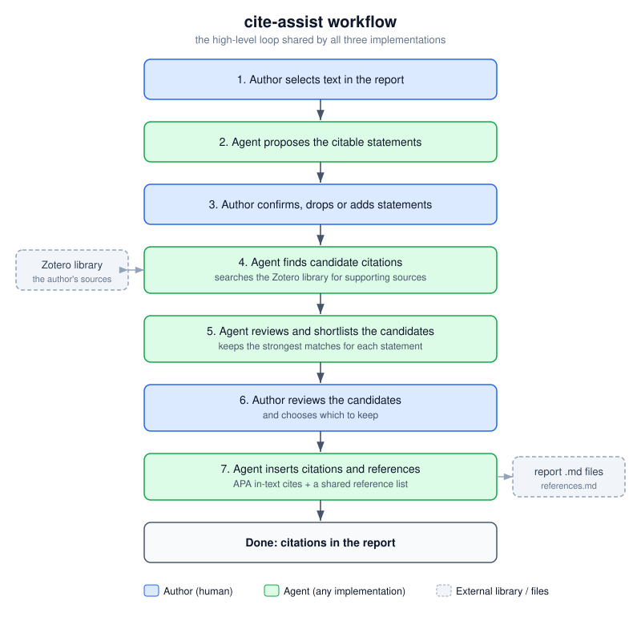

# Earlier development archive

This folder preserves phase 1, completed before development of the eResearch
conference abstract. The implementations remain available; relocation does not
mean they are invalid. The current conference workflows and manual demonstrations
are described in [the root README](../README.md).

| Folder | Purpose | Status |
| --- | --- | --- |
| [agent-cli](agent-cli/README.md) | Agent-orchestrated `refcite` CLI with a local Zotero cache and BM25/embedding retrieval | Earlier working RAG implementation; installation instructions retained |
| [agent-app](agent-app/DESIGN-app-mode.md) | Desktop GUI using `refcite` and scoped LLM calls | Earlier working app; requires sibling `agent-cli` |
| [agent-no-python-cli](agent-no-python-cli/DESIGN-agent-no-python-cli.md) | Live-API skill with starter Python fragments | Earlier alternative, not a RAG system |
| [evaluation](evaluation/README.md) | Sandbox creation, gold datasets and citation scoring | Prototype; planned multi-example, multi-model study was not completed |

The RAG CLI and app must remain adjacent unless their import bootstrap is changed.
The harness resolves this repository via `../..` from its evaluation folder;
implementation sources are archive-relative. Existing lane names and result
identifiers are preserved so old results retain their meaning.

The two retained CLI runs were mechanism tests during development, not
performance tests. Their scores do not constitute the planned comparison.
No Zotero library snapshot was archived. A snapshot is planned only if a future
large-scale performance study is undertaken.

Run implementation tests from the repository root:

```bash
conda activate cite-assist-dev
python -m pytest archive/agent-cli/tests archive/agent-app/tests -q
```

Run harness commands from `archive/evaluation`, following its operator guide.
Creating a run can overwrite sandbox working files; do not use it merely to
inspect an old run. The harness was not used for the manual conference tests.
Historical research plans and limitations remain in
[docs/RESEARCH.md](docs/RESEARCH.md), with development lessons in
[docs/LESSONS.md](docs/LESSONS.md). These are phase 1 records; notes from
2026-10-14 onward are separated into
[the phase 2 development log](../docs/DEVELOPMENT.md).

## Phase 1 workflow diagrams

The shared workflow diagram describes the author-agent review loop used to
frame the earlier implementations. It is historical context, not a diagram
of the simplified conference evaluation.



The RAG agent diagram expands the cached CLI workflow, including Zotero sync,
indexing and candidate ranking.


## Known historical omissions

The `t2-coral-sea-prev-mapping.md` dataset references three figure files under
`datasets/media` that were not included in the earlier Git repository. The
original dataset is preserved without altering its text or gold citations, but
its figures will not render. It is not a complete source-document package.