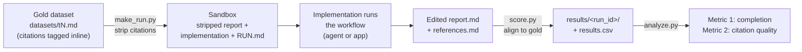

# Evaluation harness

This folder holds the **test harness** used to compare the three cite-assist
implementations (`agent-cli`, `agent-app`, `agent-no-python-cli`) on the same
citation task. It answers a practical research question: *can a generic agent
harness, or a skill file alone, match a workflow backed by a purpose-built Python
tool?*

It is a small-scale, single-author **case study** (an n-of-1 Zotero library and a
handful of short report introductions), framed as preliminary. The formal
protocol — research questions, scoring rubric, limitations — lives in
[harness/METHOD.md](harness/METHOD.md) and the study design in
[../docs/RESEARCH.md](../docs/RESEARCH.md). This README is the **operator's
guide**: how the pieces fit together and a step-by-step setup for running tests.

## How it works

Each test starts from a **gold dataset**: a short passage in which the author's
real APA citations are tagged inline. The harness strips those citations to
produce a hint-free input, runs an implementation against it in an isolated
sandbox, then scores the citations the implementation inserted back against the
gold.



The **sandbox is the anti-leakage boundary**. `make_run.py` seeds it with only
the stripped report, an empty `references.md`, the implementation itself (agent
modes), and a generated `RUN.md`. The gold texts, the scorer, and other runs'
results are never placed in the workspace the implementation sees.

### The pieces

| File | Role |
|------|------|
| [datasets/](datasets/) | Gold texts (`t1`, `t2`, `t3`, …) with citations tagged inline. |
| [harness/cite_eval.py](harness/cite_eval.py) | Parses the gold format and produces the hint-free input. |
| [harness/check_refs.py](harness/check_refs.py) | Verifies every gold citation actually exists in the Zotero library. |
| [harness/make_run.py](harness/make_run.py) | Seeds a sandbox for one run (stripped report + implementation + `RUN.md` + manifest). |
| [harness/score.py](harness/score.py) | Collects a finished run and scores its citations against gold. |
| [harness/analyze.py](harness/analyze.py) | Aggregates `results.csv` into Metric 1 (completion) and Metric 2 (quality). |
| [harness/implementations.json](harness/implementations.json) | Per-implementation setup (source folder, where to copy it, TOML overrides). |
| [harness/config.json](harness/config.json) | Paths and `min_samples_for_quality`. `cite_assist_repo` is `../..` (the repository root). |
| [run-index.csv](run-index.csv) | The planned run matrix (lanes × texts) and each run's status. |
| `sandboxes/` | Transient per-run workspaces (git-ignored; regenerated by `make_run.py`). |
| `results/` | Scored artifacts per run plus the master `results.csv`. |

## Prerequisites

- **Python 3.11+** (standard library only — no packages to install for the harness).
- **Zotero desktop running** with the local HTTP API enabled (Settings →
  Advanced → "Allow other applications on this computer to communicate with
  Zotero"). The harness talks to `http://127.0.0.1:23119`.
- **The Zotero library populated** with every source the datasets cite. Verify
  with `check_refs.py` (below).
- **Model access for the lane you want to run:**
  - *Copilot lanes* (`cli_*`, `nocli_*`): VS Code with GitHub Copilot, model
    selectable in the chat (Opus 4.8, Haiku 4.5).
  - *LM Studio lanes* (`app_gemmaE4B`, `app_gemma31b`): LM Studio serving the
    chat model **and** the `embeddinggemma-300m-qat` embedding model used by
    `refcite`'s hybrid ranking.
  - *OpenRouter lane* (`app_opus48or`): an OpenRouter API key.
- **For agent-cli and app modes only:** the shared `refcite` CLI and its offline
  Zotero cache. Set up per [../agent-cli/INSTALL.md](../agent-cli/INSTALL.md);
  the hybrid search backend needs the embedding endpoint above. The
  `agent-no-python-cli` lanes need none of this — they use the library through
  the agent alone.

This is a historical prototype, not the harness for the conference demonstrations.
The two retained CLI runs tested the harness and workflow mechanism. They were
not performance-evaluation runs; their generated scores are development outputs,
not comparative performance evidence. The planned large study was not completed.
See [the archive guide](../README.md)
and [the manual conference evaluation](../../eval_v2/README.md).

Run all harness commands from this `archive/evaluation/` folder.

## Step-by-step

### 1. Check the datasets are library-consistent

Every gold citation must exist in Zotero, or the implementation cannot possibly
find it and the run is scored unfairly. With Zotero running:

```bash
python harness/check_refs.py
```

This prints `FOUND` / `YEAR?` / `MISSING` per reference and a summary. Resolve
anything not found (add the record to Zotero, or fix the citation) before
benchmarking.

### 2. Set up a run

`make_run.py` builds the sandbox for one `(implementation, text, model)` cell:

```bash
# agent modes (Copilot)
python harness/make_run.py --impl agent-cli            --text t1 --model opus48
python harness/make_run.py --impl agent-no-python-cli  --text t1 --model haiku45

# app mode (label the provider/ranking for the RUN.md and the record)
python harness/make_run.py --impl agent-app --text t1 --model gemma-4-e4b \
    --run-id app_gemmaE4B_t1 --ranking "hybrid (embeddinggemma-300m-qat)"
```

It writes the stripped `report.md`, an empty `references.md`, a `RUN.md` with the
minimal user-side prompts, and a `.current-run.json` manifest into
`sandboxes/<impl>/`. Re-running rotates the report in place and clears any prior
citation sessions in the sandbox; pass `--refresh` to re-copy the implementation.

**Repeat runs (seeing variation).** By default the `run_id` is
`<lane>_<text>` (e.g. `cli_opus48_t1`), so a re-run overwrites the previous row
in `results.csv` and the `results/<run_id>/` folder. To keep replicates and
compare the spread, give each repeat a distinct id with `--run-id`, and pass the
**same** id to `score.py`:

```bash
python harness/make_run.py --impl agent-cli --text t1 --model opus48 --run-id cli_opus48_t1_r1
# ...run it in the sandbox...
python harness/score.py sandboxes/agent-cli --run-id cli_opus48_t1_r1
```

Each replicate then gets its own `results.csv` row and `results/` folder.

### 3. Run the workflow

- **Agent modes:** open `sandboxes/<impl>/` as its **own VS Code workspace**,
  select the model named in `RUN.md`, and follow `RUN.md`. Opening it as a
  separate workspace is what keeps the gold out of the agent's view.
- **App mode:** launch the GUI from `archive/agent-app/`
  (`python app.py`) and point it at the sandbox's `report.md`, following its
  `RUN.md`.

Follow the **accept-all policy**: accept the statements the model proposes and
the top candidate per claim; do not steer the model's control flow. A run
*completes* if it reaches inserted citations without you having to push it back
on track. Note how a run broke in the `notes` column.

### 4. Score the run

```bash
python harness/score.py sandboxes/agent-cli
```

This aligns the edited report to the gold, scores each sentence (see the rubric
in [harness/METHOD.md](harness/METHOD.md#5-scoring)), copies artifacts to
`results/<run_id>/`, and upserts a row in `results/results.csv`. A run whose
prose was reworded so it no longer aligns is flagged `alignment_ok=False`
(rewording is a workflow failure by design).

### 5. Record the manual observations

`score.py` fills the computed columns; you fill the rest of the row in
`results/results.csv` by hand:

- `completed_no_steering` — the Metric 1 judgement (did it finish unaided?).
- `copilot_credits` — from the VS Code Copilot usage panel.
- `tokens`, `seconds`, `notes`.

### 6. Aggregate

```bash
python harness/analyze.py
```

- **Metric 1** — completed runs per lane.
- **Metric 2** — mean score and the good/ok/partial/wrong/miss/false-positive
  breakdown, reported only for lanes with at least `min_samples_for_quality`
  completed runs (default 3, in `config.json`). Metric 1 therefore gates which
  lanes are eligible for Metric 2.

## The run matrix

[run-index.csv](run-index.csv) is the planned set of runs: seven **lanes**
(implementation × model × provider × ranking) across the dataset texts, with a
`status` and `notes` per run. `run_id` is `<lane>_<text>` (e.g.
`cli_opus48_t1`). The full lane list is in
[harness/METHOD.md §1](harness/METHOD.md#1-what-is-compared).

## Spinning up one combination for refinement

During development you will often want to exercise a single implementation/model
combination repeatedly while refining its `SKILL.md` or prompts — the SKILL
descriptions must be well tested and comparable **before** benchmarking. The loop
is just steps 2–4 against one cell:

```bash
python harness/make_run.py --impl agent-no-python-cli --text t1 --model opus48
# open sandboxes/agent-no-python-cli, run it, then:
python harness/score.py sandboxes/agent-no-python-cli
```

Edit the implementation in its source folder (e.g.
[../agent-no-python-cli/](../agent-no-python-cli/)), re-run `make_run.py`
(`--refresh` to re-copy), and repeat. Each cell is independent, so you can tune
one lane without touching the others.

## Reproducibility note

No Zotero library snapshot has been archived. The retained runs only tested the
mechanism; no large-scale performance comparison was undertaken. If such a study
is conducted, the plan is to record a library snapshot alongside the evaluated
implementation versions. This is a future plan, not an existing archive or an
offer to provide a snapshot on request.

The library's papers cannot be redistributed without checking their copyright
licences. The retained datasets, harness, gold tagging and scoring code support
inspection of the prototype, but an equivalent library is not an exact replay
of the original runs. Three historical dataset figures are also missing, as
described in [the archive guide](../README.md#known-historical-omissions).

## See also

- [harness/METHOD.md](harness/METHOD.md) — the formal protocol and scoring rubric.
- [../docs/RESEARCH.md](../docs/RESEARCH.md) — research questions and study design.
- [../docs/LESSONS.md](../docs/LESSONS.md) — lessons from building the implementations.
